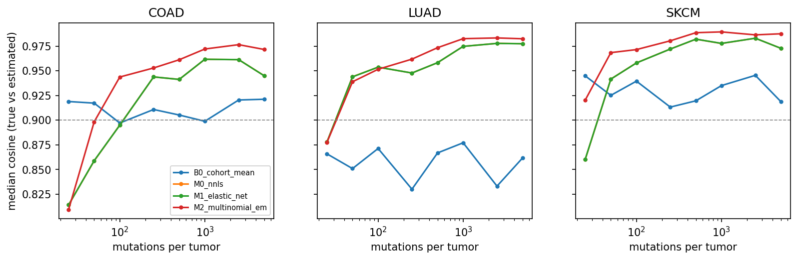
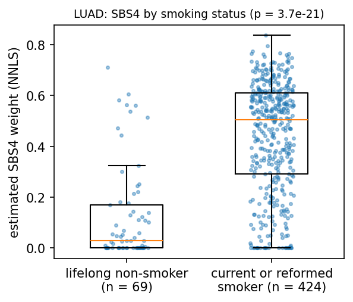

# Mutational Signature Detective: estimating signature exposures in tumors and the mutation count at which they break down

Preliminary draft for lab discussion, 2026-11-10. COMP 6721, Fall 2026.
Anas Farooqui (40347862), Hugo Xu (40064100), Bao Tran Nguyen (40257379).
Code and results: github.com/ralegionc/COMP6721-F26-PROJECT.

## Abstract

Mutational processes such as tobacco smoke, ultraviolet (UV) light and DNA-repair defects leave
characteristic patterns, called mutational signatures, in a tumor's DNA. Given a tumor's single-base
substitutions counted over 96 sequence contexts, signature attribution estimates what share of the
mutations each known signature explains. We compare a baseline and four attribution methods on three
TCGA cancer types (lung adenocarcinoma, skin melanoma and colon adenocarcinoma): non-negative least
squares (NNLS), elastic-net NNLS, a multinomial maximum-likelihood fit and, in progress, a small neural
network. Because real tumors have no known answer, we score the methods on simulated tumors calibrated
to the training patients, and check them on real tumors against known biology. On simulated tumors, the
maximum-likelihood fit is the most accurate method in all three cancer types; its gain over NNLS is
statistically significant but small. Median accuracy reaches our reliability threshold (cosine
similarity 0.90) at 25 to 250 mutations, depending on cancer type and method. On real lung tumors,
the estimated tobacco signature is much higher in smokers than in lifelong non-smokers (median weight
0.50 against 0.03). However, signatures that should be absent still receive weight in many real
tumors, which shows that simulated accuracy overstates real-world reliability.

## 1. Introduction

A tumor's genome accumulates mutations from several sources over time. Each source tends to produce
particular base changes in particular sequence contexts. For single-base substitutions (SBS), the
standard description uses 96 categories: the six possible substitutions, written from the pyrimidine
base of the pair (C>A, C>G, C>T, T>A, T>C, T>G), each combined with the 16 possible pairs of
neighbouring bases. A mutational signature is a probability distribution over these 96 categories.
The COSMIC catalogue (version 3.4) lists 86 SBS signatures, several with a known cause, such as SBS4
(tobacco smoking), SBS7a to SBS7d (UV light) and SBS2 and SBS13 (APOBEC enzyme activity) (Alexandrov et
al., 2013; Alexandrov et al., 2020).

Signature attribution, also called refitting, takes the signatures as fixed and estimates each one's
contribution to a single tumor. The result, the tumor's exposure vector, can indicate past exposures or
DNA-repair defects. Exome sequencing finds only a few hundred mutations in a typical tumor, and the
estimates become unreliable when counts are low. Published tools rarely state at what count this
happens for a given cancer type and method.

We address four research questions:

- **RQ1.** How accurately do NNLS, elastic-net NNLS, a multinomial maximum-likelihood fit and a small
  neural network recover known exposures?
- **RQ2.** Below what mutation count do the estimates stop being reliable? We define the breakdown point
  N\* as the smallest tested count from which the median cosine similarity between true and estimated
  exposures stays at or above 0.90.
- **RQ3.** How much does accuracy drop when a tumor carries a signature that the method does not know
  about?
- **RQ4.** Do the estimates agree with known biology on real tumors, for example higher SBS4 weight in
  smokers' lung tumors?

Our estimates are research outputs, not clinical diagnoses.

## 2. Related work

Alexandrov et al. (2013) extracted the first pan-cancer set of signatures with non-negative matrix
factorization; Alexandrov et al. (2020) extended it with the PCAWG whole genomes and TCGA exomes,
producing the COSMIC v3 catalogue and the per-tumor attributions we use to choose candidate signatures.
Alexandrov et al. (2016) linked SBS4 to tobacco smoking, which is the basis of our real-data check.

Attribution tools differ mainly in how they fit a tumor. deconstructSigs (Rosenthal et al., 2016) uses
an iterative least-squares search, MutationalPatterns (Blokzijl et al., 2018) uses NNLS, and
SigProfilerAssignment (Díaz-Gay et al., 2023) combines NNLS with forward and backward selection of
signatures. Huang et al. (2018) showed that attributions in low-count tumors are uncertain and proposed
assessing presence with resampling, which motivates our bootstrap intervals. Our work does not propose
a new tool. It compares fitting principles (least squares, penalized least squares, likelihood and a
learned model) under one evaluation protocol, and measures the breakdown point per cancer type.

## 3. Data

**Mutations.** We downloaded the open-access "Masked Somatic Mutation" files (MAF format) of the GDC
workflow "Aliquot Ensemble Somatic Variant Merging and Masking" for TCGA-LUAD, TCGA-SKCM and TCGA-COAD:
1,547 files (239 MB), each checked against its GDC checksum, and 1,516 clinical records. We kept
single-base substitutions supported by the MuTect2 caller in tumor samples, removed duplicate calls,
and assigned each mutation to one of the 96 contexts using the GRCh38 reference genome. None of the
723,536 reference bases recorded in the files disagreed with the genome, which confirms that the files
and genome use the same build.

| Cancer type | Samples | Median mutations per sample | Samples under 100 mutations |
| --- | --- | --- | --- |
| LUAD | 613 | 194 | 181 (30%) |
| SKCM | 469 | 390 | 86 (18%) |
| COAD | 454 | 121 | 154 (34%) |

The 1,536 samples come from 1,451 patients; 48 patients have more than one tumor sample.

**Signatures.** We use COSMIC SBS v3.4, normalized for exome sequence composition. For each cancer type
we fit only the signatures that Alexandrov et al. (2020) attributed in at least 5% of that type's TCGA
exomes, excluding the 19 signatures COSMIC labels as likely sequencing artifacts:

- LUAD (6): SBS1, SBS2, SBS4, SBS5, SBS13, SBS40a
- SKCM (7): SBS1, SBS5, SBS7a, SBS7b, SBS7c, SBS7d, SBS38
- COAD (8): SBS1, SBS2, SBS5, SBS13, SBS15, SBS17b, SBS40a, SBS44

The 2020 attributions use the older name SBS40, which COSMIC v3.4 split into SBS40a, SBS40b and SBS40c;
we use SBS40a, its closest successor.

**Clinical labels.** For the smoking check, current and reformed smokers form the positive class and
lifelong non-smokers the negative class; patients with unknown status are excluded. LUAD has 433
smokers, 75 lifelong non-smokers and 77 patients with unknown status.

**Split.** We split patients, not samples, 60/20/20 into training, validation and test sets (871, 290
and 290 patients), stratified by cancer type, using the 12-character TCGA patient identifier, so that a
patient's samples never appear in two sets. The split was made once with a fixed seed (6721) and is
stored with a checksum.

## 4. Methods

### 4.1 Simulated tumors

True exposures are unknown for real tumors, so we evaluate on simulated ones. We fit NNLS to the real
training tumors of each cancer type and estimate two distributions from those fits: a Dirichlet
distribution for exposure vectors (method of moments) and a log-normal distribution for mutation
counts. Only training patients are used, which the code checks on every run. Each simulated tumor
draws an exposure vector and a mutation count, then its 96 counts. Two sources of noise make the task
harder than the methods' own model: each tumor's signatures are randomly distorted around the COSMIC
profiles, and counts are drawn from a Dirichlet-multinomial rather than a multinomial distribution.

Per cancer type we simulate 1,000 training tumors, 200 validation tumors, and 400 test tumors: 50 at
each of eight fixed mutation counts (25, 50, 100, 250, 500, 1,000, 2,500 and 5,000). All sets are saved
once with checksums, and every method is scored on the same files.

### 4.2 Attribution methods

Let *S* be the 96 x *K* matrix of candidate signatures and *c* a tumor's 96 counts. Every method returns
a non-negative exposure vector that sums to 1.

- **B0, cohort mean.** Returns the average training exposure for every tumor, ignoring its mutations.
  It plays the role of a majority-class baseline; any useful method must beat it.
- **M0, NNLS.** Minimizes the squared difference between the tumor's mutation profile *c* / sum(*c*)
  and *S e*, subject to *e* >= 0 (Lawson and Hanson, 1974), then rescales *e* to sum to 1.
- **M1, elastic-net NNLS.** Adds an L1 penalty, which sets small weights to zero, and an L2 penalty,
  which shrinks weights (Zou and Hastie, 2005). The penalty strength (1e-7 to 1e-3) and the share of L1
  (0.1, 0.5 or 0.9) are chosen on the validation tumors by mean absolute error on present signatures.
- **M2, multinomial maximum likelihood.** Treats each mutation as drawn from one signature, so the
  counts follow a multinomial distribution with probabilities *S e*. We maximize the likelihood with the
  expectation-maximization (EM) algorithm (Dempster et al., 1977). Unlike least squares, this weights
  each context by how many mutations it holds, which suits low counts. Resampling a tumor's mutations
  and refitting gives bootstrap intervals for each weight.
- **M3, multilayer perceptron (in progress).** Planned design: a small neural network that maps a tumor's normalized
  profile and its log mutation count to an exposure vector through a softmax output, trained on the
  simulated training tumors with early stopping on the validation tumors.

None of these methods is Bayesian; M2's intervals are frequentist.

### 4.3 Evaluation

- **Cosine similarity** between true and estimated exposure vectors (1 is a perfect match).
- **Mean absolute error (MAE)** over the signatures that are truly present in each tumor.
- **Presence detection.** A signature is present when its weight is at least 5%. We report
  per-signature F1 and PR-AUC (area under the precision-recall curve), averaged over signatures.
  Between 39% and 53% of presence labels on our test sets are "absent", so plain accuracy would
  reward a method that predicts "absent" everywhere; we do not use it.
- **Breakdown point N\*** as defined in RQ2.
- **Paired comparisons.** For every pair of methods we run a two-sided Wilcoxon signed-rank test on
  per-tumor scores (both methods see the same tumors) and correct the p-values with Holm's method
  (Wilcoxon, 1945; Holm, 1979), both with all mutation counts pooled and at each count separately.
- **Real-data checks.** A one-sided Mann-Whitney U test of SBS4 weight in smokers against lifelong
  non-smokers, the Spearman correlation of SBS4 weight with pack-years among smokers, and negative
  controls: we add signatures that should be absent (UV signatures in lung tumors, SBS4 in melanoma)
  and measure how much weight they receive.

## 5. Results

### 5.1 Accuracy on simulated tumors (RQ1)

| Cancer | Method | Median cosine | MAE (present) | Macro F1 | PR-AUC |
| --- | --- | --- | --- | --- | --- |
| LUAD | B0 | 0.859 | 0.131 | 0.647 | 0.614 |
| LUAD | M0 NNLS | 0.959 | 0.089 | 0.870 | 0.940 |
| LUAD | M1 elastic net | 0.961 | 0.080 | 0.880 | 0.942 |
| LUAD | M2 multinomial EM | 0.966 | 0.080 | 0.873 | 0.946 |
| SKCM | B0 | 0.931 | 0.111 | 0.409 | 0.473 |
| SKCM | M0 NNLS | 0.966 | 0.090 | 0.762 | 0.840 |
| SKCM | M1 elastic net | 0.968 | 0.088 | 0.756 | 0.838 |
| SKCM | M2 multinomial EM | 0.980 | 0.073 | 0.800 | 0.864 |
| COAD | B0 | 0.913 | 0.100 | 0.444 | 0.492 |
| COAD | M0 NNLS | 0.930 | 0.101 | 0.749 | 0.822 |
| COAD | M1 elastic net | 0.919 | 0.092 | 0.758 | 0.825 |
| COAD | M2 multinomial EM | 0.955 | 0.082 | 0.779 | 0.844 |

*Table 1. Test-set results on 400 simulated tumors per cancer type, all mutation counts pooled.*

M2 has the highest median cosine in every cancer type and the lowest MAE (tied with M1 in LUAD). With all counts pooled, the
paired tests find M2 better than M0 on both cosine and MAE in all three types (Holm-adjusted p between
6e-6 and 9e-24), but the median paired cosine gain is small: 0.005 in LUAD, 0.010 in SKCM and 0.017 in COAD.
M2 is also better than M1 in SKCM and COAD, while the two do not differ in LUAD (p = 0.5).

M1's validation search chose a penalty of 3e-5 (LUAD, SKCM) or 1e-4 (COAD), each time with the smallest
L1 share offered (0.1). M1 lowers MAE compared with M0 in all three types (by 0.002 to 0.009), but in
COAD it lowers the median cosine, most visibly at high counts (0.931 to 0.943 against M0's 0.945 to
0.962 at 1,000 mutations and above). A single penalty chosen on validation tumors, whose counts
follow the real, mostly low-count distribution, over-shrinks tumors with many mutations; a penalty that
depends on the mutation count may work better. The chosen penalty mostly shrinks weights rather than
removing signatures, which suggests that the per-type candidate lists are already small enough that
removing signatures adds little.

The cohort-mean baseline is a strong competitor on cosine when one signature dominates. In SKCM, where
SBS7a dominates most tumors, B0 reaches a median cosine of 0.931, and in COAD the paired test does not
separate B0 from NNLS on cosine (p = 1). Its presence F1 (0.41 to 0.65) is far below every real method,
so we treat F1 and PR-AUC as the main measures of whether a method identifies the right signatures.

### 5.2 Breakdown point (RQ2)

*Figure 1. Median cosine between true and estimated exposures at each mutation count (50 simulated
test tumors per point). The dashed line marks 0.90.*

| Method | LUAD | SKCM | COAD |
| --- | --- | --- | --- |
| B0 | not reached | 25 | 2,500 |
| M0 NNLS | 50 | 50 | 250 |
| M1 elastic net | 50 | 50 | 250 |
| M2 multinomial EM | 50 | 25 | 100 |

*Table 2. Breakdown point N\*: the smallest tested mutation count from which the median cosine stays at
or above 0.90.*

COAD is the hardest type: it has the most candidate signatures (8), several of which (SBS1, SBS5,
SBS40a) have flat, similar profiles. M2 lowers its breakdown point from 250 to 100 mutations. Since 34%
of real COAD samples have fewer than 100 mutations, a large share of real colorectal tumors fall below
the point where even the best method is reliable. Above about 1,000 mutations, the curves of the fitted
methods level off between about 0.93 and 0.99 rather than approaching 1, because the simulated signature distortion limits
accuracy however many mutations are observed.

### 5.3 Real tumors (RQ4)

*Figure 2. NNLS estimate of SBS4 weight per LUAD patient, by smoking status.*

Smokers' lung tumors receive a median SBS4 weight of 0.50, against 0.03 for lifelong non-smokers (424
and 69 patients with mutation data; one-sided Mann-Whitney p = 3.7e-21). Among smokers, SBS4 weight
does not correlate with reported pack-years (Spearman rho = 0.08, p = 0.16, n = 348); self-reported
pack-years are noisy, and the signature records the mutations in the sampled tumor rather than the
total exposure.

The negative controls are less reassuring. When the UV signatures SBS7a to SBS7d are added to the
lung fit, they receive at least 5% of the weight in 29% of LUAD patients, although lung tissue is not
exposed to UV light. When SBS4 is added to the melanoma fit, it receives at least 5% in 9% of SKCM
patients. Signatures that should be absent absorb part of the mutations, particularly in tumors with
few mutations.

## 6. Discussion

On simulated tumors, the choice of fitting principle matters less than the number of mutations: all
three fitted methods are within 0.04 of each other in median cosine, while moving from 25 to 250
mutations changes accuracy far more. The likelihood-based M2 gains most where counts are low and
signatures are similar (COAD), which matches its design, since it accounts for the counting noise that
least squares ignores.

The simulated results are an upper bound. The simulated tumors follow the same signature model the
methods assume, with only moderate distortion, so breakdown points of 25 to 250 mutations are
optimistic; a pilot reported in our project plan found that NNLS needed 500 to 1,000 mutations. The
negative controls on real tumors point the same way: a presence threshold of 5% that works on
simulated tumors calls absent signatures present in a substantial share of real ones. A presence
threshold that rises as the mutation count falls is a natural correction, and our planned unseen-
signature experiment (E3) will measure the cost of model mismatch directly.

## 7. Limitations

- Ground truth exists only for simulated tumors, and the simulator shares the methods' model.
- Open-access mutation files remove some low-frequency variants, lowering counts in low-burden tumors.
- Signatures found in fewer than 5% of a type's tumors are not candidates; for example the POLE
  signatures SBS10a and SBS10b (about 2% of colorectal tumors) are excluded, so tumors driven by them
  will be fitted poorly. The published attributions predate COSMIC v3.4, so the newest signatures are
  not candidates either.
- Results cover exome data from three cancer types and may not transfer to whole genomes or other types.
- The neural network (M3) and the coverage of M2's bootstrap intervals are not yet evaluated.

## 8. Remaining work

- **M3.** Train and tune the neural network on the same simulated sets and add it to every comparison.
- **E3, unseen signatures.** Simulate tumors containing a signature left out of the candidate list
  (for example SBS10a/b or SBS17a) and measure the loss in accuracy; test sparse tumors with only one to
  three active signatures.
- **Real-data checks.** More negative controls and a count-dependent presence threshold chosen on
  validation tumors.
- **Intervals.** Measure how often M2's 95% bootstrap intervals contain the true weight.
- **Error analysis.** Which signatures are confused with each other, and how errors depend on count.
- Optional: a cohort-shift experiment by tissue source site.

## References

Alexandrov, L. B., Nik-Zainal, S., Wedge, D. C., et al. (2013). Signatures of mutational processes in
human cancer. *Nature*, 500, 415-421.

Alexandrov, L. B., Ju, Y. S., Haase, K., et al. (2016). Mutational signatures associated with tobacco
smoking in human cancer. *Science*, 354(6312), 618-622.

Alexandrov, L. B., Kim, J., Haradhvala, N. J., et al. (2020). The repertoire of mutational signatures
in human cancer. *Nature*, 578, 94-101.

Blokzijl, F., Janssen, R., van Boxtel, R., and Cuppen, E. (2018). MutationalPatterns: comprehensive
genome-wide analysis of mutational processes. *Genome Medicine*, 10, 33.

COSMIC Mutational Signatures, version 3.4. https://cancer.sanger.ac.uk/signatures/

Dempster, A. P., Laird, N. M., and Rubin, D. B. (1977). Maximum likelihood from incomplete data via the
EM algorithm. *Journal of the Royal Statistical Society, Series B*, 39(1), 1-38.

Díaz-Gay, M., Vangara, R., Barnes, M., et al. (2023). Assigning mutational signatures to individual
samples and individual somatic mutations with SigProfilerAssignment. *Bioinformatics*, 39(12), btad756.

Holm, S. (1979). A simple sequentially rejective multiple test procedure. *Scandinavian Journal of
Statistics*, 6(2), 65-70.

Huang, X., Wojtowicz, D., and Przytycka, T. M. (2018). Detecting presence of mutational signatures in
cancer with confidence. *Bioinformatics*, 34(2), 330-337.

Lawson, C. L., and Hanson, R. J. (1974). *Solving Least Squares Problems*. Prentice-Hall.

Rosenthal, R., McGranahan, N., Herrero, J., Taylor, B. S., and Swanton, C. (2016). deconstructSigs:
delineating mutational processes in single tumors distinguishes DNA repair deficiencies and patterns
of carcinoma evolution. *Genome Biology*, 17, 31.

Wilcoxon, F. (1945). Individual comparisons by ranking methods. *Biometrics Bulletin*, 1(6), 80-83.

Zou, H., and Hastie, T. (2005). Regularization and variable selection via the elastic net. *Journal of
the Royal Statistical Society, Series B*, 67(2), 301-320.
